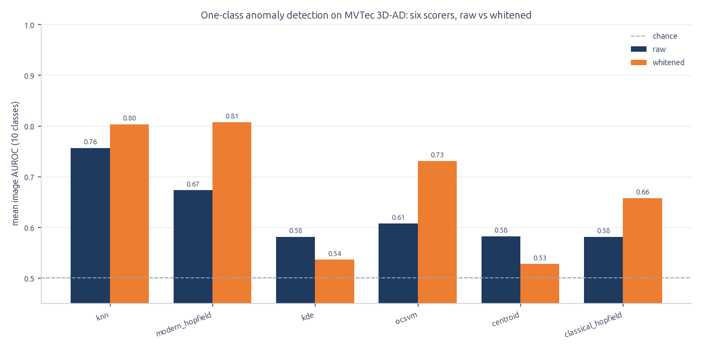
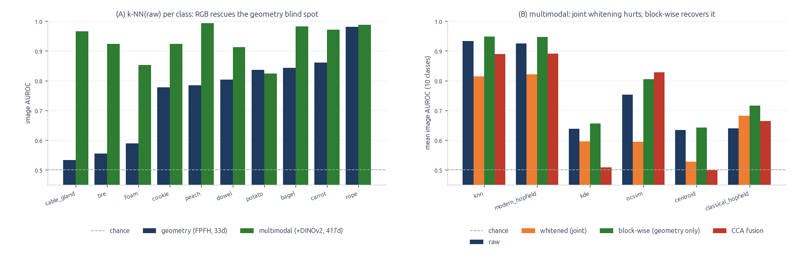
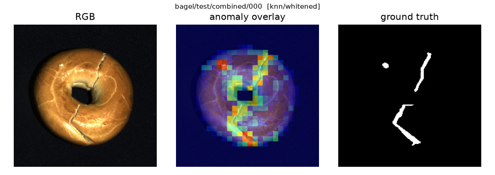

# oneclass3d

One-class 3D anomaly detection on **MVTec 3D-AD**: fit on normal scans only, flag unseen
defects. A frozen per-patch descriptor feeds a memory bank of normal patches, and **six
anomaly scorers** are compared on equal footing, each on **raw** and on **whitened**
features. No training, no GPU: everything from the raw point clouds to the figures runs
on a CPU in this repository.

## Main results

Mean image AUROC over the 10 classes, full memory bank:

| features | best scorer | image AUROC |
|---|---|---|
| geometry (FPFH, 33-d), whitened | Modern Hopfield / k-NN | 0.807 / 0.803 |
| geometry + RGB (FPFH + DINOv2, 417-d), block-wise whitened | k-NN / Modern Hopfield | 0.948 / 0.947 |

- **Whitening is the main lever on geometry**: Modern Hopfield 0.673 → 0.807, k-NN
  0.756 → 0.803.
- **Modern Hopfield ties k-NN but does not beat it**: paired bootstrap Δ = +0.004,
  95% CI [−0.001, +0.009].
- **RGB rescues the classes geometry cannot see**: cable_gland 0.53 → 0.97, tire
  0.55 → 0.92 (raw k-NN).
- **Localization works even where detection is weak**: geometry-only pixel-AUROC 0.951,
  AUPRO 0.849.
- **At a fixed threshold the picture is harsher**: calibrated on normal validation scans
  for a 5% false-positive rate, whitened k-NN has precision 0.96 and recall 0.44.







[`RESULTS.md`](RESULTS.md) has the per-class tables, the robustness studies and the
deployment metrics.

## Method

- **Features.** Each scan is resampled to 224×224. The background plane is removed by
  RANSAC, seeded on the image border, and stray points are removed by DBSCAN. FPFH
  (Open3D) is computed per point, average-pooled to a 28×28 patch grid and L2-normalized
  (33-dim). With `features: mm`, a frozen DINOv2 ViT-S/14 token, which lands on the
  same 28×28 grid, is appended to each patch (417-dim). Extraction is single-threaded
  and bit-deterministic.
- **Memory bank.** For each class, `Xi` holds every patch of every normal training scan.
- **Scoring.** Each scorer gives each test patch a normality score against `Xi`. The
  image score is the minimum over the scan's patches, and AUROC negates it.
- **Whitening.** A per-class transform is fit on the normal bank only: mean-centring,
  shrunk covariance, `W = C'^{-1/2}`, then re-normalization. On the multimodal
  descriptor, *block-wise* whitening transforms only the geometry block.

| scorer | normality s(x) | hyperparameter |
|---|---|---|
| `knn` | −(distance to the k-th nearest normal patch) | k = 1 |
| `modern_hopfield` | (1/β)·logsumexp(β·Xiᵀx), a soft nearest neighbour | β = 100 |
| `kde` | Gaussian KDE log-density | Scott's rule |
| `ocsvm` | signed distance to a one-class RBF-SVM boundary | ν = 0.1, γ = scale |
| `centroid` | x · mean direction (maximum-bias baseline) | – |
| `classical_hopfield` | ‖Xiᵀx‖² (quadratic baseline) | – |

Hyperparameters are fixed defaults and are never tuned on the test set. The robustness
studies also use Mahalanobis (k-means clusters with Ledoit-Wolf covariances) and a
k-NN + Mahalanobis hybrid (`src/scorers.py`).

## Installation

```bash
python -m venv .venv && . .venv/bin/activate
pip install torch torchvision --index-url https://download.pytorch.org/whl/cpu   # multimodal only
pip install -r requirements.txt
```

The geometry-only pipeline does not need torch, torchvision or timm. Download MVTec
3D-AD and point `paths.data_root` in `config.yaml` at it (default `data/mvtec3d`).

## Usage

```bash
python extract.py geom   # raw scans -> cache/features/*_abs.npz (one-time, ~30 min CPU)
python run.py            # six scorers x {raw, whitened} -> results/tables/auroc.{csv,md}
python plot.py           # -> results/figures/{auroc_bar,mh_beta_sweep}.png
pytest -q

python extract.py rgb    # + DINOv2 tokens -> *_mm.npz (one-time, ~24 min CPU)
# set `features: mm` in config.yaml, then:
python run.py            # -> results/tables/auroc_mm.{csv,md}
python plot.py           # also writes mm_vs_geom.png and kde_bandwidth_view.png
```

With `features: abs` and the full bank, `run.py` checks that raw k-NN reproduces the
10-class mean of 0.7563 exactly. `bank_cap: 12000` in `config.yaml` brings `run.py` from
about 10 to about 4 minutes, at the cost of up to about 0.03 mean AUROC.

Each study reads the feature cache only:

| command | question | output |
|---|---|---|
| `python significance.py` | is a scorer significantly different from k-NN? | `significance.csv`, `results/significance.md` |
| `python ocsvm_fit.py` | Nyström on the full bank or exact kernel on a subsample? | `ocsvm_fit.csv` |
| `python plane_ablation.py` | does removing the background plane help? | `plane_ablation.csv` |
| `python localize.py` | where is the defect? (pixel-AUROC, AUPRO) | `localization.csv`, `figures/localization/` |
| `python extract.py rgb_v3`, `python encoders.py` | DINOv2 or DINOv3 as the RGB encoder? | `encoders.csv` |
| `python topk_sweep.py` | is min-pool the best patch→image aggregation? | `topk_sweep.csv` |
| `python contamination.py` | robustness to defective patches in the bank | `contamination.csv` |
| `python hybrid.py` | which k-NN/Mahalanobis mix does `select_alpha` pick? | `hybrid.csv` |
| `python bank_size.py` | smaller banks and k-center coresets | `bank_size.csv` |
| `python extract.py corrupt`, `python corruption.py` | robustness to corrupted geometry | `corruption_grid.csv`, `results/mitigation.md` |
| `python corruption.py eps` | do adaptive DBSCAN eps modes help under noise? | `results/eps_modes.md` |
| `python cross_class.py` | does a bank of one class detect defects in another? | `cross_class.csv` |
| `python border_check.py` | does the RANSAC border-strip assumption hold? | `border_check.csv` |
| `python extract.py validation`, `python operating_point.py` | precision/recall at a fixed threshold | `operating_point.csv`, `results/operating_point.md` |
| `python timing.py` | latency and memory footprint | `timing_*.csv`, `results/timing_summary.md` |

Tables are written to `results/tables/` and figures to `results/figures/`.

## Layout

```
config.yaml         all parameters: paths, extraction, scorers, studies
extract.py          raw scans -> feature caches (geom, rgb, rgb_v3, validation, corrupt)
run.py              main comparison: class x {raw, whitened} x scorer -> AUROC + bootstrap CI
plot.py             main figures
src/data_io.py      read the organized xyz TIFF scans and ground-truth masks
src/preprocess.py   resampling, RANSAC plane removal, DBSCAN cleanup
src/features.py     per-point FPFH -> 28x28 patch pooling -> cache
src/data.py         cache -> memory bank Xi and test patches
src/scorers.py      scorers, whitening, block-wise whitening, CCA fusion
src/evaluate.py     AUROC, aggregation, bootstrap CI, operating-point metrics
src/corrupt.py      point-cloud corruptions
src/repro.py        content-derived seeds
src/style.py        figure style
*.py (other)        studies, see the table above
tests/              unit tests and a synthetic extract -> run integration test
results/            tables, figures and short reports
```

## Data and license

The code is released under the [MIT License](LICENSE).

MVTec 3D-AD (Bergmann et al., VISAPP 2022) is licensed **CC BY-NC-SA 4.0**:
non-commercial research only, cite the paper, no redistribution. The dataset is not
included here. DINOv2 weights are Apache 2.0. DINOv3 weights (`extract.py rgb_v3`,
optional) are under the DINOv3 License, which requires a "Built with DINOv3"
attribution.
